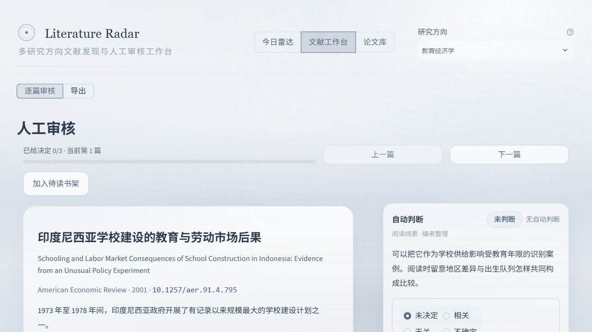

# Literature Radar

一份可以每天接着读的经济学论文库。按方向追踪期刊，读中英文摘要，参考 AI 初筛，再由研究者亲自决定哪些论文值得留下。

[工作原理与实测](docs/design.md) · [在本机运行](docs/local.md) · [部署到 Streamlit](docs/maintain.md)

## 从一篇论文开始

在「今日雷达」打开 Duflo 关于印度尼西亚学校建设的论文。教育经济学关注学校供给如何改变受教育年限；切到劳动经济学，同一篇论文又能用来讨论工资回报。两个方向引用同一份资料，各自保留判断。加入「待读书架」后，可以按本方向的清单导出 RIS。

默认工作区从四篇有 DOI 的公开论文开始。可以阅读中英文节选、保存自己的决定和备注、收藏并导出。每个访客使用独立的临时数据库，无需登录或填写密钥。Windows 启动脚本打开同一应用，使用个人数据库，支持持续追踪与按需 AI 分析。

## 日常工作

| 在哪里 | 能完成什么 |
| --- | --- |
| 今日雷达 | 记住关注的期刊和兴趣词，找回上次读到的位置。 |
| 文献工作台 | 按日期逐刊翻页检索，补齐公开摘要，翻译与初筛后逐篇审核。关闭应用后保留队列，下次打开可继续。 |
| 论文库 | 按方向、期刊、年份、决定或 DOI 找回文章，保存备注，导出 RIS、CSV 或 Markdown。 |

**判断如何保存。** 模型建议记录当时使用的题名或摘要；人工决定和备注另行保存。补到新摘要可以重新分析，人的判断继续保留。

**检索如何恢复。** 题录、队列进度与阅读状态分别存储。模型请求有批次上限，公开摘要复查独立执行。Windows 和云端运行同一份 Python、Streamlit 与 SQLite 源码。

## 验证记录

Windows 全新安装后，六刊周检索得到 11 条书目，保存的判断与备注在重启和 CSV 导出后均可找回。Ubuntu 24.04 上也通过浏览器完成了阅读、审核和 RIS 下载。两个同时打开的访客会话各自保存自己的书架。

另一次四篇论文的实际处理中，三篇取得公开摘要并完成 DeepSeek 翻译与初筛，一篇在重启复查后仍缺摘要。[查看验收范围和边界](docs/design.md)

源码、维护与部署入口见[维护说明](docs/maintain.md)。
